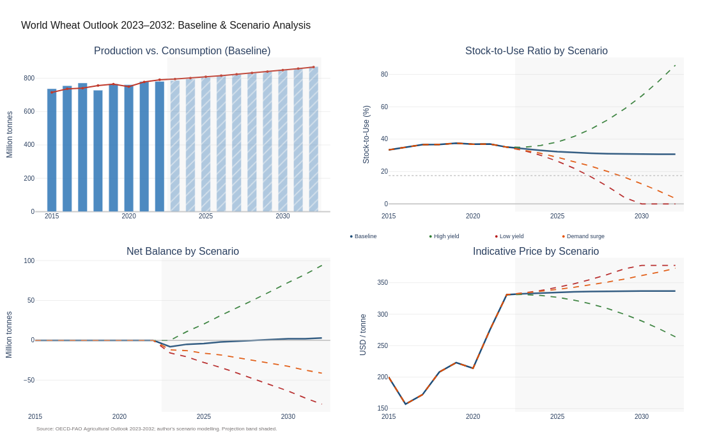

# 🌾 Agricultural Outlook Scenario Explorer

> A Python pipeline that replicates the OECD-FAO *Agricultural Outlook* supply/demand projection framework for **world wheat**, with interactive scenario-shock analysis and publication-quality charts.

---

## Demo



*2×2 briefing dashboard: supply/demand balance, stock-to-use ratio, net balance, and indicative price — baseline vs. three shock scenarios.*

---

## Motivation

The [OECD-FAO Agricultural Outlook](https://www.oecd.org/agriculture/topics/agricultural-outlook/) is the benchmark annual publication for 10-year commodity projections used by governments, international organisations, and agri-businesses.  This repository shows how to:

1. **Ingest** the public Outlook balance-sheet data (wheat, world aggregate)
2. **Replicate** the Outlook's tabular projection format in Python
3. **Extend** the baseline with user-defined supply/demand shocks
4. **Visualise** the results in the clean, minimal style of an Outlook chapter

---

## Data source

| Item | Details |
|------|---------|
| **Primary source** | OECD-FAO Agricultural Outlook 2023-2032, Annex C. Statistical Annex |
| **DOI** | [10.1787/08801ab7-en](https://doi.org/10.1787/08801ab7-en) |
| **Live API** | `https://sdmx.oecd.org/public/rest/data/OECD.TAD.ATM,DF_AGRICULTURAL_OUTLOOK/` (SDMX 3.0 REST) |
| **Fallback** | Embedded calibrated dataset in `data_loader.py` (used when the API is unreachable) |
| **Coverage** | 2015–2022 historical actuals; 2023–2032 Outlook projections |
| **Units** | Thousand metric tonnes (kt); prices in USD/tonne |

The pipeline first attempts the live OECD SDMX API; if unreachable (firewall, offline), it automatically falls back to the embedded data, which is carefully calibrated to the published 2023 edition.

---

## Methodology

### Baseline projection

The OECD-FAO Outlook baseline is used directly as the starting trajectory.  For each projection year *t*:

```
production(t)  = OECD baseline production(t)
consumption(t) = OECD baseline consumption(t)
stocks(t)      = stocks(t-1) + production(t) − consumption(t)
trade_balance  = production(t) − consumption(t)          [world residual]
stock-to-use   = stocks(t) / consumption(t)  × 100
```

### Scenario shocks

Three built-in shocks are applied **multiplicatively on top of the baseline growth rates**:

| Scenario | Shock | Interpretation |
|----------|-------|----------------|
| **High Yield** | Production CAGR +1 pp/yr | Accelerated technological progress (gene editing, precision irrigation) |
| **Low Yield** | Production CAGR −1 pp/yr | Climate-driven yield stagnation, conflict disruption |
| **Demand Surge** | Consumption CAGR +0.5 pp/yr | Biofuel mandates, faster-than-expected protein transition in MENA |

For a production shock of `Δ` pp in year *i*:

```
production_scenario(t_i) = production_baseline(t_i) × (1 + Δ/100)^i
```

### Price signal

A simple stock-to-use elasticity links the balance sheet to an indicative world price:

```
price_scenario(t) ≈ price_seed × (1 + ε × Δ(S/U))
  where ε = −0.4  (stock-to-use price elasticity, based on FAO literature)
```

> **Important:** The price series is a *model-derived signal*, not an OECD-FAO official price forecast.

---

## Repository structure

```
agri-outlook/
├── data_loader.py       # data ingestion (live OECD API + embedded fallback)
├── scenario_engine.py   # projection maths + scenario definitions
├── visualise.py         # Plotly chart factory (6 chart types)
├── main.py              # CLI entry point
├── requirements.txt
├── notebooks/
│   └── outlook_explorer.ipynb   # interactive Jupyter walkthrough
└── figures/             # auto-generated output
    ├── 01_supply_demand_baseline.html
    ├── 02_supply_demand_low_yield.html
    ├── 03_stock_use_ratio.html
    ├── 04_trade_balance.html
    ├── 05_price_outlook.html
    └── 06_scenario_dashboard.html   ← start here
```

---

## Quick start

```bash
# 1. Clone
git clone https://github.com/<you>/agri-outlook.git
cd agri-outlook

# 2. Install dependencies
pip install -r requirements.txt

# 3. Run the full pipeline (HTML + PNG output)
python main.py

# HTML only (no kaleido required)
python main.py --formats html

# Extend horizon to 2035
python main.py --horizon 2035

# Run a subset of scenarios
python main.py --scenarios baseline low_yield demand_surge
```

Open `figures/06_scenario_dashboard.html` in any browser for the interactive briefing dashboard.

### Jupyter notebook

```bash
jupyter notebook notebooks/outlook_explorer.ipynb
```

The notebook walks through each step and includes a **custom scenario cell** where you can set any yield/demand shock interactively.

---

## Extending the model

### Add a new scenario

```python
# scenario_engine.py
SCENARIOS["climate_crisis"] = Scenario(
    name="climate_crisis",
    label="Climate Crisis (−2 pp yield, +0.3 pp demand)",
    color="#880e4f",
    yield_delta_pp=-2.0,
    demand_delta_pp=0.3,
)
```

### Change commodity

Replace the `EMBEDDED_WHEAT` dict in `data_loader.py` with the maize (corn) or rice balance sheet from the annex of the Outlook.  All downstream code is commodity-agnostic.

---

## Limitations & caveats

- **Partial equilibrium** – prices are indicative signals; there is no cross-commodity linkage.
- **Linear shocks** – real supply disruptions are non-linear and geographically heterogeneous.
- **Trade identity** – world exports = world imports by construction; bilateral trade flows are not modelled.
- **No policy feedback** – government stock releases, subsidies, and export restrictions are not captured.

This tool is designed for **rapid scenario sketching and visual communication**, not for replacing the full Aglink-Cosimo model used internally by the OECD.

---

## Licence

MIT — free to use and adapt with attribution.

---

## Citation

If you use this code in research or policy work, please cite both this repository and the underlying OECD-FAO data:

```
OECD/FAO (2023), OECD-FAO Agricultural Outlook 2023-2032,
OECD Publishing, Paris, https://doi.org/10.1787/08801ab7-en.
```
